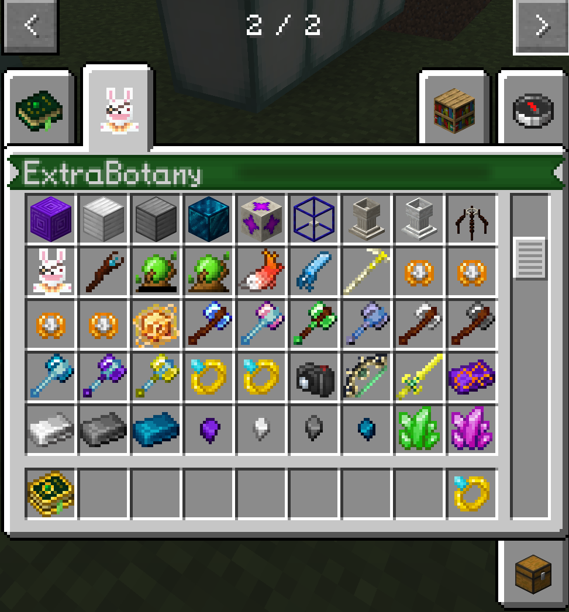
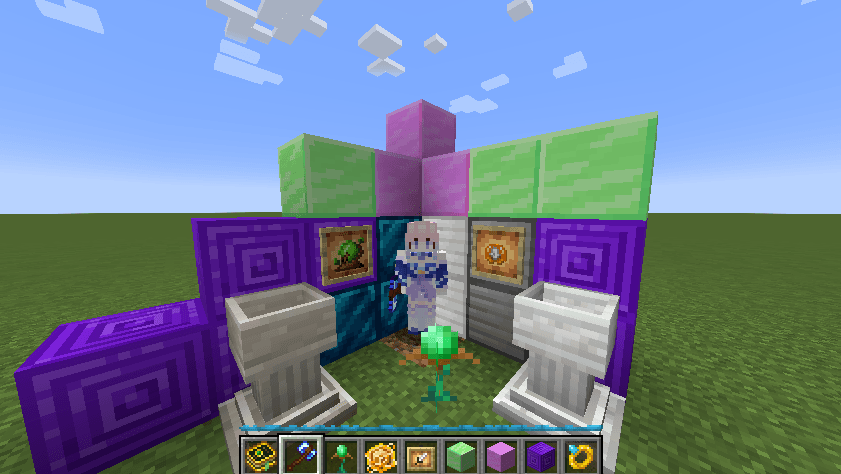

# ExtraBotany: Reburn

## [中文](README.md)

## About this branch

Magellan67 maintains this branch. The branch continues Lounode's "ExtraBotany: Reburn" and targets Minecraft 1.21.1 (NeoForge).

This project is a tribute to 似水流年. Thank you for such a great mod.

The reference for the port is the original "Extra Botany" of ExtraMeteorP: content and values that the original has are restored from the original, and the content that Reburn added stays.

- [docs/OVERVIEW_en.md](docs/OVERVIEW_en.md): what this version did, the differences from the original, and what is not verified yet.
- [docs/PORT_AUDIT.md](docs/PORT_AUDIT.md): the record of each comparison and each correction.
- [docs/ACCEPTANCE.md](docs/ACCEPTANCE.md): the items to check in the game and the items that need a decision.




## Requirements

| Component | Version |
|---|---|
| Minecraft | 1.21.1 |
| NeoForge | 21.1.248 or a later 21.1.x |
| Botania | 456 |
| Patchouli | 1.21.1-93 or later |
| Curios | 9.5.1 or later |
| JEI, EMI, KubeJS | optional |

This branch supports NeoForge only. The Forge 1.20.1 and Fabric versions of Reburn are not in this repository.

Old worlds stay compatible: the registry names of items, blocks and entities, and the data keys in saved worlds, did not change.

## Content

- Relics: Garden of King's Law, Key of Flamescion, Spear of Subspace, Judah Oath, Silent Eternity, ALL FOR ONE, Excalibur, Void Archives, Core of The Void and others.
- Baubles: Gem of Conquest (the wearer becomes the Herrscher of Thunder), Master Band of Mana, the four stones and The Community, the two mounts (Motor and UFO) and others.
- Armor: Goblin Slayer, Shadow Warrior, Starry Idol, Pleiades Combat Maid, Shooting Guardian, Silent Sages.
- Flowers: Trade Orchid, Woodienia, Reikarlily, Stonesia, Edelweiss, Omniviolet, Stardust Lotus, Manalink and others.
- Blocks: Mana Buffer, Quantum Mana Buffer, Flux Manafield, Mana Liquefaction Device, Livingrock Barrel, Cocoon of Desire, the pedestals, Mana Charger.
- Bosses: Guardian of Gaia III, Herrscher of the Void, Ego.
- The textures that Reburn made again, nearer to the style of the vanilla game.

## For modpack makers

[docs/kubejs.md](docs/kubejs.md) shows the recipe types, the data maps and the use of KubeJS.

## Build from source

JDK 21 is necessary. Gradle downloads all other dependencies.

```bash
./gradlew build
```

The result is `build/libs/extrabotany-neoforge-1.21.1-<version>.jar`.

| Command | Function |
|---|---|
| `./gradlew runClient` | Starts the development client. |
| `./gradlew runServer` | Starts the development dedicated server. |
| `./gradlew runGameTestServer` | Runs all game tests, then stops. |
| `./gradlew runGameTestServer -Pgametest_namespaces=extrabotany_perf` | Runs the performance scenarios and not the tests. The results are in the log, in lines that start with `EB_PERF`. |
| `./gradlew runData` | Runs the data generators. The output goes to `src/generated/resources`. |

### Layout

| Directory | Content |
|---|---|
| `src/main` | The mod. The release JAR only has this content. |
| `src/generated/resources` | The output of the data generators. Do not edit it by hand: `runData` makes the full directory again. |
| `src/datagen` | The code of the data generators. It does not go into the release JAR. |
| `src/gametest` | The game tests and their structure files. They do not go into the release JAR. |
| `docs` | The project overview, the port audit record, the acceptance checklist, the comment style, the guide for modpack makers. |

The code comments are in Chinese and English. [docs/COMMENT_STYLE.md](docs/COMMENT_STYLE.md) gives the rules.

## Credits

- ExtraMeteorP: the author of the original "Extra Botany".
- Lounode: the author of "ExtraBotany: Reburn".
- Urranium (textures), Keletu (armor model).
- Vazkii and all contributors of Botania.

## License

MIT, see [LICENSE](LICENSE).
